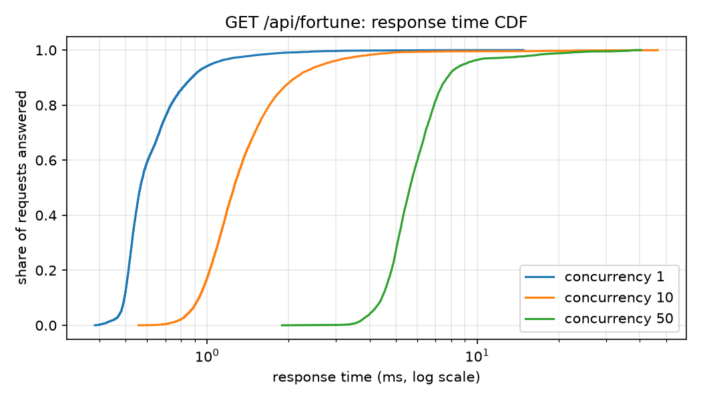
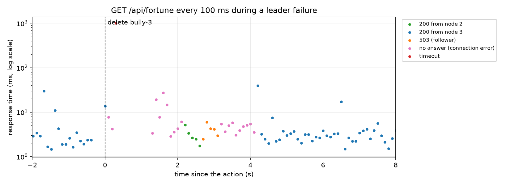

# Experiments: results and findings

Material for the report's two experiment sections: what we ran, what we measured, and what it
shows. Both experiments ran on 20 November 2026. The raw data and the plots are in
[experiments/results/](../experiments/results), and how to rerun them is in
[loadtest/README.md](../loadtest/README.md) and [experiments/README.md](../experiments/README.md).

## Key numbers

- **Load:** a single leader pod served up to **about 8 000 requests/s** with **no errors**.
  The median response time was 0.6 ms with 1 client and 5.6 ms with 50 parallel clients.
- **Leader failure:** users could not get a fortune for **about 2.0–2.7 s** (mean 2.36 s when
  the leader pod is deleted).
- **The election itself took 20–290 ms** (mean 0.08 s). Most of the outage is spent first
  noticing that the leader is gone (mean 1.2 s, at most 2 s) and then routing traffic to the
  new leader (mean 1.0 s).
- **A restarted leader takes over again.** `bully-3` has the highest id, so when its pod comes
  back it wins the next election. Users then see a second, shorter outage of 1–2 s.

## Test setup

| | |
|---|---|
| Cluster | Docker Desktop Kubernetes v1.36.1 (kubeadm), a single node |
| Machine | Apple M1, 8 GB RAM. The Docker VM has 8 CPUs and 4 GB |
| App | 3 replicas (StatefulSet `bully`), `BULLY_ALGORITHM=improved`, check interval 2 s, T = 1 s |
| Routing | readiness probe on `/leader` every 1 s (`failureThreshold: 1`), NodePort 30080 |
| Client | Python + aiohttp on the same Mac, using `http://localhost:30080` |

The client and the cluster share one machine, so network latency is close to zero. The
response times below are a best case; a remote user would also pay the network round trip.

## Experiment 1: load test

### Method

[loadtest/loadtest.py](../loadtest/loadtest.py) sends `GET /api/fortune` from N parallel
workers. Each worker sends its next request as soon as the previous one is answered (a closed
loop). First it sends 50 warm-up requests that are not recorded, then 10 000 recorded
requests. We ran it with N = 1, 10 and 50.

For each request we record the response time, the HTTP status and the pod that answered. From
those we compute throughput (requests/s), the 50th, 95th and 99th percentiles and the maximum
of the response time, and the error rate.

### Results

| Parallel clients | Requests | Requests/s | Mean | p50 | p95 | p99 | Max | Errors | Answered by |
|---:|---:|---:|---:|---:|---:|---:|---:|---:|---|
| 1 | 10 000 | 1 504 | 0.7 ms | 0.6 ms | 1.0 ms | 1.9 ms | 14.8 ms | 0 % | bully-3 |
| 10 | 10 000 | 6 465 | 1.5 ms | 1.3 ms | 2.7 ms | 4.8 ms | 46.6 ms | 0 % | bully-3 |
| 50 | 10 000 | 8 001 | 6.2 ms | 5.6 ms | 9.0 ms | 21.5 ms | 40.4 ms | 0 % | bully-3 |

*Figure: share of requests answered within a given time, log scale.*

### What it shows

- **Only the leader serves.** All 30 000 requests were answered by `bully-3`. The readiness
  probe keeps the two followers out of the Service, so they receive no traffic at all.
- **No errors under load.** Every request got a 200.
- **The single leader is the bottleneck.** From 1 to 10 clients, throughput grows about 4×
  and response times stay around 1 ms. From 10 to 50 clients, throughput grows only by
  another quarter and the median response time grows about fourfold. The leader is close to
  its limit of about 8 000 requests/s, so extra requests wait in a queue.
- **The numbers are consistent.** In a closed loop, mean response time = clients ÷ throughput
  (Little's law): 10 / 6 465 s = 1.5 ms and 50 / 8 001 s = 6.2 ms, matching the measured
  means.
- **More replicas would not help throughput.** The design uses every pod except the leader
  only as a backup. Adding replicas adds fault tolerance but not capacity, because one pod
  serves all traffic.

## Experiment 2: leader failure

### Method

[experiments/failover.py](../experiments/failover.py) acts as a user: it requests
`GET /api/fortune` every 100 ms over one keep-alive connection, with a 1 s timeout. After 5 s
it takes the leader (`bully-3`) out, keeps polling for 30 s, and saves every pod's log with
timestamps. Before each run it waits until all pods are up and node 3 has served for 5 s. We
took the leader out in three ways, 5 runs each:

| Mode | Command | What it simulates |
|---|---|---|
| delete | `kubectl delete pod bully-3` | a graceful stop; Kubernetes recreates the pod |
| force | `kubectl delete pod bully-3 --grace-period=0 --force` | a crash; the pod is recreated at once |
| scale | `kubectl scale statefulset bully --replicas=2`, back to 3 after 15 s | the leader stays down |

We split the time users wait into steps. The first three come from the pods' logs and the
client's request log, which share one clock:

| Step | From | To |
|---|---|---|
| Detection | the leader is taken out | a follower logs that node 3 doesn't answer |
| Election | detection | a follower logs `NORMAL: coordinator of nodes [1, 2]` |
| Routing | election | the client gets its first 200 from the new leader |
| **Outage** | the client's last 200 before the failure | its first 200 after it |

### Results

Mean, with min–max in brackets, over 5 runs per mode:

| Mode | Detection | Election | Routing | Outage | Failed requests | First served by | Old pod back after |
|---|---|---|---|---|---|---|---|
| delete | 1.24 s (0.41–1.85) | 0.08 s (0.05–0.17) | 1.03 s (0.68–1.63) | **2.36 s** (2.10–2.70) | 13.6 (11–17) | node 2, 5 of 5 runs | 2.70 s (2.25–3.16) |
| force | 0.80 s (0.32–1.82)¹ | 0.02 s¹ | 0.75 s¹ | **2.00 s** (1.10–2.30) | 15.4 (10–21) | node 2 in 1 run, node 3 in 4 | 0.98 s (0.88–1.15) |
| scale | 1.11 s (0.51–2.00) | 0.15 s (0.03–0.29) | 1.11 s (0.75–1.47) | **2.35 s** (2.11–3.01) | 11.6 (11–12) | node 2, 5 of 5 runs | 1.33 s after scaling back (1.17–1.55) |

¹ In 4 of the 5 force runs, node 3 was back before node 2 had taken over; in one of them, no
follower had even noticed it was gone. Those runs have no election or routing time, so the
figures come from the single run where node 2 won.

When `bully-3` came back, it was leader again about 20 ms after starting. Where node 2 had
taken over, this caused a **second outage**:

| Mode | Second outage (node 2 → node 3) | Failed requests | of which 503 |
|---|---|---|---|
| delete | 1.0–1.9 s | 9–18 | 5–9 |
| scale (after scaling back to 3) | 0.9–2.0 s | 4–19 | 3–9 |

*Figure: run 1 of the delete mode, one dot per request (response time on a log scale).*

The figure shows a delete run step by step:
- At 0 s, `bully-3` is deleted, and its pod stops 0.09 s later.
- Requests fail with connection errors (pink) until node 2 serves at +2.2 s (green).
- The new `bully-3` pod starts at +2.7 s and immediately takes leadership back.
- Node 2 answers 503 (orange) until its readiness probe fails. Then connections fail until
  `bully-3` is Ready, and node 3 serves from +4.2 s (blue).

Plots of the other modes:
[failover-force.png](../experiments/results/failover-force.png) and
[failover-scale.png](../experiments/results/failover-scale.png). In the scale plot, node 2
serves from about +2.2 s until scaling back to 3 at +15 s.

### What it shows

**The outage is the sum of three steps:** 1.24 + 0.08 + 1.03 = 2.35 s, against a measured
outage of 2.36 s in the delete runs. Each step can be explained:

- **Detection (about 1.2 s, at most 2 s).** Followers check the coordinator only every
  2 s (the check interval). A failure happens at a random point in that cycle, so detection
  takes 1 s on average and up to 2 s. In theory it can also include the timeout T = 1 s (an
  upper bound of 3 s). We saw values below 1 s, though. In our UDP transport, a closed port or
  an unknown host counts as "no answer" immediately, without waiting for T. After a pod is
  deleted, its port closes and its DNS name disappears, so the timeout is usually not needed.
- **Election (20–290 ms).** Once a follower has detected the failure, the improved Bully
  algorithm needs only a few message exchanges between the two remaining nodes. This is the
  smallest part of the outage by far.
- **Routing (about 1 s).** Kubernetes checks `/leader` every second, so it notices the new
  leader after 0.5 s on average. It then updates the Service's endpoints before traffic
  reaches the new leader.

**What users notice:**

- During the outage, users get no answer rather than a 503. With no Ready pod, the Service
  has no endpoints, so connections are refused at once (status 0 in our data). Only 1–2
  requests per run timed out.
- 503s appear only during the hand-back to node 3. Node 2 has then lost leadership but is
  still in the Service's endpoints until its next probe, which is at most 1 s.
- The website's JavaScript retries for up to 15 s, so a user clicking "another cookie" sees
  "Electing a new leader…" for about 2 s, possibly twice, and then gets a fortune. Reloading
  the page during the outage shows a browser error, because only the fortune request retries.

**Graceful stop vs. crash.** The mode mostly changes how fast the old leader comes back, and
therefore whether users see one outage or two:

| | delete (graceful) | force (crash) | scale (stays down) |
|---|---|---|---|
| Old pod back after | about 2.7 s | about 1.0 s | only when scaled back |
| Outages | two (2.4 s, then 1–2 s) | usually one (about 2.2 s) | one, plus one when scaled back |
| Node 2 serves | about 2 s | usually never | until scaled back |

After a graceful delete, Kubernetes waits for the old pod to be fully removed before it
creates a pod with the same name. A force delete removes it at once, so `bully-3` is often
back before node 2 has won or been routed to.

**Taking leadership back has a cost.** The Bully algorithm always picks the highest live id.
A recovered node 3 therefore forces a leader change that isn't needed, because node 2 was
working fine. In a website, this doubles the number of outages per failure. An alternative
would be to let a recovered node rejoin without starting an election (a variant of the
algorithm, not the classic Bully).

**How the outage could be shortened:**
- a shorter check interval (faster detection, but more heartbeat messages);
- a shorter readiness probe period (faster routing, but more probe requests);
- serving from any pod and forwarding to the leader, so routing doesn't depend on readiness.

### Limitations

- A single-node cluster on a laptop, and the client on the same machine: no real network.
- The client polls every 100 ms, so each client-side time is accurate to about ±0.1 s.
- 5 runs per mode give a range, not a reliable distribution.
- Only the improved algorithm was measured. To compare with the original, set
  `BULLY_ALGORITHM=original` in `deploy/k8s/statefulset.yaml`, run `make redeploy`, and then
  `make failover RESULTS=experiments/results/original`.
- The election uses UDP. A lost packet looks like a crash. This didn't happen in our runs,
  but it would in a lossy network.

## Data files

All in [experiments/results/](../experiments/results):

| File | Contents |
|---|---|
| `load.csv` | Experiment 1, one row per request: `concurrency, start_s, latency_ms, status, leader, pod` |
| `load-cdf.png` | The CDF figure above |
| `failover-<mode>.csv` | Experiment 2, one row per request: `run, t` (Unix time)`, latency_ms, status, error, leader, pod` (status 0 = no HTTP answer) |
| `failover-<mode>.json` | Per run: the settings and the exact times of the action |
| `failover-<mode>-pods.log` | Every pod's log for each run, each line prefixed with `run<K> <pod>`; `bully-3-before` is the old leader's log up to its end |
| `failover-<mode>.png` | Run 1 of the mode, as in the figure above |

`make report` prints all tables again and redraws the plots from these files, without a
cluster.
